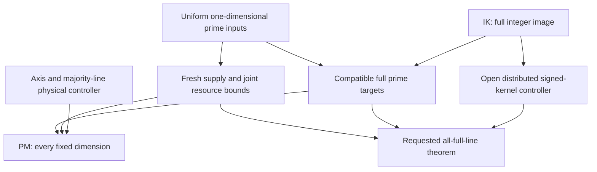

# Full signed-line prime hypercubes: the general mechanism and its current boundary

Composition author and coordinator: `/root`. Component authors are identified
in the canonical sources below. This is the isolated all-fixed-dimension
workspace. The primary all-full-line theorem remains open at this checkpoint.
The integer-image, prime-target and majority-line results below are complete
conventional author proofs, awaiting an exact-revision independent review.
No kernel verification, numerical prime-array cutoff, novelty or small-order
universality is asserted.

## 1. Exact objective and achieved theorem

Fix an integer k >= 2, then let n=2m+1 increase through odd integers.
Use centered coordinates I={-m,...,m}. A required full signed-coordinate line
has a nonempty varying-coordinate set A, relative signs sigma_i in {+1,-1},
fixed coordinates outside A, and points x_i=sigma_i t for t in I. Simultaneous
sign reversal describes the same set. For n>=3 there are exactly

\[
 L_k(n)=\sum_{r=1}^k\binom kr2^{r-1}n^{k-r}
       ={(n+2)^k-n^k\over2}.                           \tag{G1}
\]

This gives 2n+2, 3n^2+6n+4, and 4n^3+12n^2+16n+8 in dimensions 2,3,4.
Every coordinate-section diagonal is included. Short shifted diagonals,
arbitrary slopes, wrapped lines and higher-dimensional section sums are not
part of this family. At n=1 the line sets coalesce and [3] is harmless.
Dimension one is excluded: its only line sum is fixed by the pool.

The requested objective is:

> For every fixed integer k >= 2 there is N(k) such that for every odd
> n >= N(k), a bijection of exactly {p_2,...,p_(n^k+1)} to I^k has prime
> sum on every full signed-coordinate line.

The quantifier order is essential. This manuscript does not assert one
threshold independent of k, any growing-dimension range, or every small odd n.

**Theorem PM (achieved all-k signed-family theorem).** For every fixed
integer k >= 2 there is N_M(k) such that for every odd n >= N_M(k), exactly
the first n^k odd primes admit a bijective arrangement in which all axes and
every full signed-coordinate line varying in more than k/2 coordinates have
prime sum. Repeated sums are allowed.

The stronger universal nearby odd-target statement is UM(k) in
[hyperk_controller.md](hyperk_controller.md), Section 8. The missing families
in PM are exactly those with

\[
                     2\le |A|\le\lfloor k/2\rfloor.   \tag{G2}
\]

Thus PM recovers the full signed-line family when k=2,3. The reviewed frozen
4D theorem separately supplies all families at k=4; PM alone is weaker in
that dimension. It is not being labeled completion of the all-full-line order.

| Diagnostic dimension | Lines made prime by PM | Families still missing from PM |
|---:|---|---|
| 5 | 5n^4 + 40n^2 + 40n + 16 | 20n^3 lines varying exactly two coordinates |
| 6 | 6n^5 + 120n^2 + 96n + 32 | 30n^4 pair lines and 80n^3 triple lines |

These are symbolic consequences of one variable-k proof, not separate
dimension-five and dimension-six constructions used as an induction.

## 2. Proof of PM and dependency graph

Set X=p_(n^k+1), T=sum_(j=2)^(n^k+1) p_j, and mu=T/n^(k-1).
The [joint prime-target theorem KPT](hyperk_targets.md), Section 6, supplies
prime targets for the *entire* full signed-line family, all within mu^(3/5)
of mu. They satisfy every two-block partition identity and each axis total
is exactly T. Restrict this target vector to PM's family. In particular the
axis tensor margins agree, and each majority-coordinate target tensor has
the prescribed marginal relation to the axes required by UM(k).

For fixed k, X~k n^k log n and mu~(k/2)n^(k+1)log n, so

\[
 {\mu^{3/5}\over X}\asymp_k
       n^{(3-2k)/5}(\log n)^{-2/5}\longrightarrow0.     \tag{G3}
\]

All targets are eventually odd primes and lie inside UM(k)'s radius
ceil(n^(3/5))X. UM(k) therefore realizes them by actual disjoint prime-pair
swaps in a bijection of the exact initial pool. Its proof first plans joint
supports, assigns fresh entries, centers complete reservoirs, completes the
unused pool, repairs residues and then corrects the targets. It preserves
every preceding corrected family. The necessary finite-depth resource
inequalities and complete-bundle concentration are also stated and proved in
[hyperk_resources.md](hyperk_resources.md).

Every hypothesis holds for every sufficiently large odd n, with k fixed.
The maximum of the finitely many analytic, geometric and capacity thresholds
gives N_M(k). No step requires a congruence subsequence of n or a different
pool. This proves PM. QED.

The all-k integer-image theorem is valuable for the full objective, but PM's
physical proof checks its smaller compatibility interface directly. It need
not invoke an arbitrary full integer lift.

The edge from IK to the target box means that the target construction plus
IK yields integer liftability; KPT's prime/partition conclusion itself is
proved without IK. The open node is not assumed by PM.

## 3. The exact integer compatibility milestone

The canonical [integer manuscript](hyperk_incidence.md) defines A_(k,n) over
Z and proves IK: for odd n>=3^k, its image consists precisely of the integer
vectors satisfying all two-parameter partition identities on disjoint signed
coordinate blocks. The image is saturated. No additional eventual congruence
is needed. A lift with every entry r modulo q exists exactly when every target
is nr modulo q, including q sharing factors with n. In particular compatible
odd targets have odd integer lifts.

The proof models a line row by a multilinear polynomial. Assign a different
noncentral reflection orbit to each signed block, of which there are
(3^k-1)/2. A positive integer monomial ordering makes the designated term of
each block polynomial monic and the designated leading monomials pairwise
coprime. Integral leading-term cancellation proves that all row relations are
generated by disjoint-block partition relations and that the row lattice is
primitive. Dualizing its explicit integral direct-sum decomposition yields
the complete image theorem. The central coordinate has its own low-weight
variables throughout; it is not treated as a free reflection orbit.

The stable kernel dimensions obey a finite-in-k recurrence. If kappa_k(n)
is the integer-kernel rank, then

\[
 \kappa_0=1,\qquad
 \kappa_{k+1}=n\kappa_k-
       \sum_{j=0}^k\binom kj2^j\kappa_{k-j}.           \tag{G4}
\]

The incidence rank is n^k-kappa_k(n). Formula (G4), not numerical rank
extrapolation, gives the stable dimension polynomials. Small-order torsion
is explicitly retained by exact Smith operation certificates at n=3 for
k=2,...,6. The threshold 3^k concerns the integer lattice only; it is not a
prime-permutation cutoff.

The same monic construction gives a bounded-size integral kernel basis with
coefficients bounded solely by k. Its expansion coefficients are bounded by
the input array's sup norm. The basis uses common marker coordinates, however,
so its geometric supports can concentrate. Its coarse general right inverse
also has an unaffordable power of n. These estimates are recorded rather than
silently upgraded to bounded-load physical control.

## 4. Joint prime targets and the changing reserve weights

The canonical [target manuscript](hyperk_targets.md) assigns a prime q_S to
each ordinary set S of absolute fixed-coordinate labels, forgetting repeated
labels; the empty-set body value uses q_{ {0} }. Both partitions of every
signed two-parameter section add the same absolute label to S, so their terms
agree one by one. This checks all signed block identities uniformly in k.

For r=k-1, the two finishing classes of m variables have weights

\[
        a_r=2^r,\qquad b_r=3^r-2^r-1\quad(r\ge2).
\]

Their gcd equals the gcd of all noncentral weight classes and is always a
power of two. A prime center in an appropriate reduced class modulo twice
that gcd repairs the necessary residue. A bounded discrepancy from the bulk
variables is then absorbed by two exact-sum prime lists of length m. At r=1
one list suffices. The construction pays the actual list lengths, the complete
auxiliary modulus range and every window hypothesis of frozen FL. It uses
uniform one-dimensional interval counts, with no prime-pattern theorem of
growing complexity. Values of targets may repeat without repeating an entry
of the prescribed array pool.

The special behavior at k=5 is instructive: the reserve weights are 16 and
64, the gcd is 16 and the center modulus is 32. The dimension-four values
8 and 18 cannot simply be copied. The general valuation proof accommodates
this without losing the entire odd-order tail.

## 5. Physical architecture and the remaining failure

Two architectures have been pursued.

The direct compatible-generator architecture now has the full integer image,
finite-size kernel generators, and explicit pure selectors that affect one
body direction and no proper signed lines. It still lacks a distributed
integral expansion with uniformly bounded support load. Fixed common markers
are an exact algebraic device but concentrate too many required physical
stages. Choosing separate markers independently introduces a residual that
must itself be corrected. A list of compatible targets or signed increments
is not a permutation controller.

The recursive marginal architecture gives the completed U(k) and UM(k).
It has 2k-3 axis capacity levels: k-2 nested aggregate levels, one joint
two-axis level, and k-2 higher tensor levels. This corrects the coupled totals
of the actual globally assigned subpools. It never invokes a lower-dimensional
prime theorem on an unrelated slice pool. Descending majority-block stages
then use generic unit selectors times bounded-degree graph products on the
complement. Their complete signature is computed, every stage uses 2^(k-1)
fresh equal-gap prime pairs, and their support is packed with line-by-line
caps. Since k-r<r, all incidental contractions have fewer varying coordinates
than the native r-family, so the descending order is triangular.

At r<=k/2 that inequality fails. A contraction entirely in the complement
can have the same or larger varying-set size. In dimension four this is the
shared pair trace repaired by the reviewed MP4 marker construction. In
arbitrary dimension it creates a hierarchy of shared signed-partition traces
and complementary kernel tensors. The target identities describe those
interactions exactly, but do not by themselves distribute the correcting
swaps. The outstanding BK interface in the controller source asks for sparse
pairable templates, bounded coefficient and per-cell load, an integral
residue solver, and the stratum bounds needed by physical packing.

Pure selectors and compatible-vector expander flows are additional proved
tools in the incidence manuscript. They remove two local obstacles, while
leaving the distributed recursion open. In particular a zero sum of compatible
vectors does not authorize rounding every component independently; the
compatible-flow lemma rounds inside the actual lattice and pays a tree repair.

## 6. A resource ladder that survives arbitrary finite depth

For any proved finite depth D(k), choose

\[
 a_j={3\over5}+{3j\over20(D(k)+1)},\quad K_j=\lceil n^{a_j}\rceil,
 \quad\delta=n^{-1/5}.
\]

The top exponent stays below 3/4, regardless of finite D. Every adjacent
gap is positive after k is fixed. Thus later capacities absorb earlier errors
times any fixed logarithmic power; total reservation O_k(n^(k-1)K_D) is
smaller than the worst reduced-class midpoint supply by a positive power;
and midpoint bias, complete-bundle fluctuation and changed unused-pool mean
are all o(K_0X). The full symbolic ledger is in the resource source.

For UM(k), D(k)=3k-floor(k/2)-4. Its diagnostic depths are 9 at k=5 and
11 at k=6. A longer proved hierarchy could use the same formula with its
own finite depth. This solves the exhaustion of a fixed decimal exponent
list. It does not solve a failed geometric recurrence or license k growing
with n.

## 7. Evidence, independent review and recovery

The exact source and review pins, commands and active ownership are maintained
in [HYPERK_HANDOFF.md](../HYPERK_HANDOFF.md). Component programs independently
enumerate full line sets, replay small integer lattices, check actual equal-gap
prime stages, verify the weighted prime completion, and reject corruptions.
Higher-dimensional target fixtures explicitly decline an arrangement claim.
The actual partial prime-stage fixtures verify disjoint entries and complete
signatures; they are not complete prime-line arrays.

The parent square/cube/4D proofs and their review records remain frozen.
The public source is Mira-Cult/math `c212563021093355c6cb33bf6e6731b43b32edac`.
The local parent is the reviewed 4D delivery
`112c2bca0d38f82391a34994b63153e7ec08aa74`, science
`b837e307fc41975d0fb332c8215d6835ba47a271`. No cutoff campaign is modified.

| Question | Mathematical status at this author checkpoint |
|---|---|
| Full integer compatibility for all fixed k, odd n>=3^k | Proved by IK |
| Joint prime targets with exact T and all partition identities | Proved by KPT |
| Odd integer lifts of those prime targets | Proved by IK + KPT |
| Pairable pure body-unit selectors, finite complexity in k | Proved by PS |
| Global finite-depth fresh supply and complete-bundle centering | Proved under explicitly stated geometric hypotheses |
| Exact-pool axes and majority-coordinate signed prime lines, all fixed k | Proved by PM through the physical UM(k) controller |
| Distributed bounded-load full signed-kernel controller | Open; candidate recurrence and fixed-marker obstruction isolated |
| Requested full signed-line prime theorem for every fixed k | Open |
| Numerical N(k), growing k, every small odd side length | Not claimed |

Independent review status is recorded separately in the handoff; the word
proved in this table describes completeness of the conventional author
argument, not reviewer acceptance. There is no remote CI or kernel claim
implicit in any finite test.
