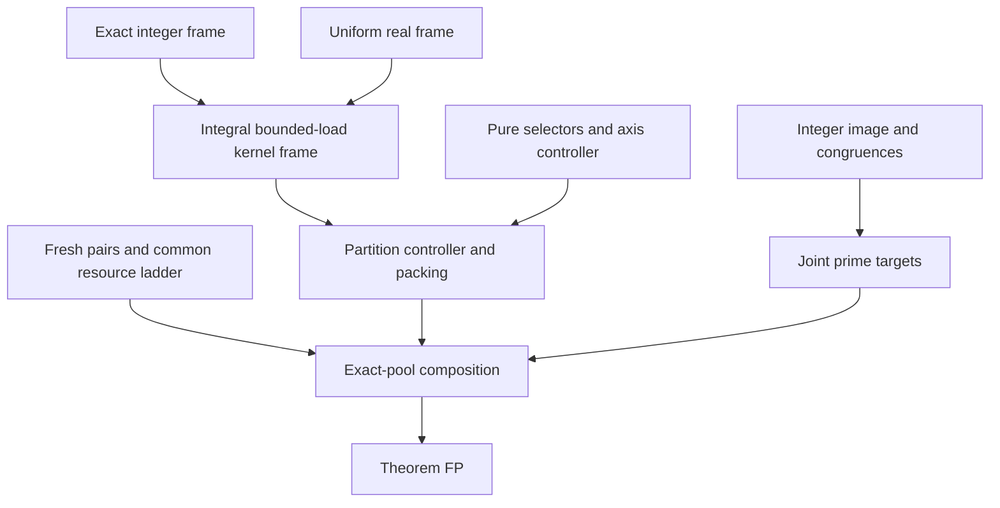

# Full signed-coordinate prime hypercubes in every fixed dimension

Author and composition owner: `/root`. This is a new author manuscript,
separate from the frozen partial results. Its scientific and review status
must be read from the current [handoff](../HYPERK_HANDOFF.md). Manuscript
labels are local. No claim below is represented as independently reviewed
until an exact published revision has actually received that review. The
full theorem below is an author candidate pending that review, not an
announcement of an accepted result.

## 1. Statement, geometry, and dependencies

**Theorem FP.** For every integer $k\ge2$ there is an integer $N(k)$
such that, for every odd integer $n\ge N(k)$, the exact first $n^k$
odd primes admit a bijective placement in $I^k$, where

$$
 I=\{-m,\ldots,m\},\qquad n=2m+1,
$$

for which every full signed-coordinate line has prime sum. A line has a
nonempty varying-coordinate set $A\subseteq[k]$, normalized signs
$\sigma_{\min A}=1$, and fixed coordinates outside $A$; its varying
coordinates are $x_i=\sigma_i t$, $t\in I$. Repeated sums are allowed.

The quantifier order is fixed $k$, then all sufficiently large odd $n$.
The threshold is qualitative and may be ineffective. There is no assertion
for $k$ growing with $n$, for every small odd order, for shifted shorter
diagonals, or for section or hyperplane sums. The case $k=1$ is excluded.

For $n\ge3$ the line inventory is

$$
 L_k(n)=\sum_{r=1}^k\binom kr2^{r-1}n^{k-r}
       =\frac{(n+2)^k-n^k}{2}.
$$

It gives $2n+2$, $3n^2+6n+4$, and
$4n^3+12n^2+16n+8$ for $k=2,3,4$. A singleton has a degenerate
line inventory and has no role in the eventual theorem.

Put

$$
 P=\{p_2,\ldots,p_{n^k+1}\},\quad X=\max P,\quad T=\sum_{p\in P}p,
 \quad \bar p=T/n^k,\quad \mu=n\bar p.
$$

We prove the stronger physical interface below and apply the joint prime
targets already proved in [hyperk_targets.md](hyperk_targets.md). The
new algebraic ingredients have separate canonical proofs:

* [hyperk_reconstruction_alt.md](hyperk_reconstruction_alt.md): an exact
  integral frame for the full signed kernel, with bounded support and
  point degree, and coefficient bound $C_d n^d E$.
* [hyperk_full_controller.md](hyperk_full_controller.md): a uniform real
  frame chosen before its demand, with coefficient bound $C_{d,\eta}n^\eta E$
  and point degree $C_{d,\eta}\log n$.
* [hyperk_distributed_kernel.md](hyperk_distributed_kernel.md): their
  integral composition, arbitrary composite moduli, and the physical
  signed templates required here.

The existing canonical inputs remain unchanged:

* [hyperk_incidence.md](hyperk_incidence.md), IK: for odd $n\ge3^k$, the
  entire integer image consists exactly of the disjoint-block partition
  identities; it is saturated. Compatible odd targets have an odd lift.
* [hyperk_controller.md](hyperk_controller.md), U and AP: the $2k-3$
  axis levels, residue passes, and their placement around a previously
  reserved set of $o(n)$ cells on every full signed line.
* [hyperk_kernel_research.md](hyperk_kernel_research.md), PS: finite pure
  selectors, with disjoint signed checkerboard pieces and unit native
  contraction.
* [hyperk_resources.md](hyperk_resources.md), FS and JC: grouped fresh
  equal-gap prime pairs, complete scalar intervals, and complete-bundle
  centering with the changed mean of the unused pool paid explicitly.

## 2. Exact target interface

For a signed block $H=(A,\sigma)$, let $C_H$ denote contraction along
the signed equality line, leaving the coordinates outside $A$. Contractions
on disjoint coordinate sets commute. A target tensor $y_H(c)$ is indexed
by the fixed coordinates of the line. Its compatibility condition is

$$
 C_Jy_H=C_Hy_J \qquad(H,J\text{ disjoint signed blocks}).       \tag{F1}
$$

This includes singleton blocks, every section margin, and every shared
trace. In addition, an entire axis-direction total is the exact integer
$T$; (F1) then gives this same total in every direction.

**Theorem FC, physical controller.** Fix $k\ge2$. For every sufficiently
large odd $n$, any odd integer full-line target vector satisfying (F1),
the exact directional total $T$, and

$$
             \max_{H,c}|y_H(c)-\mu|\le n^{3/5}X                 \tag{F2}
$$

is realized by a permutation of $P$.

The current manuscript proves FC from the stated, separately proved kernel
frame interface. It does not replace a permutation by an integer lift.
All actual entries used below are distinct members of $P$.

For $d\ge1$, write

$$
 K_d=\{M\in\mathbb Z^{I^d}: C_HM=0
             \text{ for every nonempty signed block }H\},
 \qquad K_0=\mathbb Z.
$$

Here is the precise distributed-kernel input, in the form used below.
For fixed $d\ge1$, $\eta>0$, and sufficiently large odd $n$, there
is a predetermined family $\mathcal N_d$ of integer tensors with:

1. Every tensor belongs to $K_d$, has entries in $\{0,1,-1\}$,
   support at most $s_d$, and an explicit pairing of its positive and
   negative cells into legal switch pairs. Constants may depend on
   $d,\eta$, never on $n$.
2. The family has at most $C_{d,\eta}n^d\log n$ members, and each
   cell belongs to at most $B_d(n)\le C_{d,\eta}\log n$ supports.
3. Every $M\in K_d$, $E=\|M\|_\infty$, has an exact integer
   expansion in that family with scalar coefficients at most

$$
           C_{d,\eta}\{n^\eta E+n^d\log n\}.                  \tag{F3}
$$

4. The same family contains an integral subframe that spans the kernel
   over every ring $\mathbb Z/h\mathbb Z$, including composite $h$
   and $h=1$, with scalar representatives $0,\ldots,h-1$.
5. Every real $M\in K_d\otimes\mathbb R$ lies within
   $R_d(n)\le C_{d,\eta}\log n$, in cell sup norm, of an integer
   element of $K_d$.

For $d=0$ the single scalar template $1$ gives all these conclusions
with constant bounds. Item 5 follows by rounding the real frame
coefficients: at a cell, at most $B_d(n)$ rounding errors of size at
most $1/2$ occur. This also explains why it is a lattice statement,
not a division by $n$ in a residue ring.

## 3. The finite partition hierarchy

A nonaxis signed partition $\pi$ is a nonempty collection of pairwise
disjoint signed blocks, all of size at least two. Let

$$
 b=|\pi|,\qquad F=[k]\setminus\bigcup_{H\in\pi}H,
 \qquad d=|F|\le k-2b.
$$

There are finitely many such structural types for fixed $k$. Their
placements are the $n^d$ fixed-coordinate tensors on $F$. The number
of levels is $\lfloor k/2\rfloor$, indexed by $b$ in descending
order. No growing list of exponents is inferred from finitely many dimensions.

For a compatible residual full-line vector $e_H$, define its shared trace

$$
 e_\pi=\left(\prod_{J\in\pi\setminus\{H\}} C_J\right)e_H,
                 \qquad H\in\pi.                              \tag{F4}
$$

It is independent of the selected $H$ by (F1). If all axes have zero
residual and all partitions with more than $b$ blocks have zero shared
trace, then

$$
                         e_\pi\in K_d.                         \tag{F5}
$$

Indeed a singleton contraction in $F$ is zero by the axis identity.
A larger signed block $J\subseteq F$ gives exactly
$e_{\pi\cup\{J\}}=0$. These are every contraction defining $K_d$.
This argument works integrally and over every residue ring.

If all original line residuals have magnitude at most $E$, then

$$
                         \|e_\pi\|_\infty\le n^{b-1}E.          \tag{F6}
$$

Thus shared traces cannot be assigned the unscaled line-error budget.
Section 5 pays for this factor by $m^{b-1}$ separate compatible pieces.

### 3.1 Complete signature of one native partition switch

For each $H\in\pi$, take a pure selector $Q_H$ from PS: it has
native $H$-contraction one, every proper signed contraction zero, and
every other signed full-body contraction zero. Choose all its nonzero
reflection-orbit labels disjoint from every other selector and from the
entire alphabet of a template $N\in\mathcal N_d$. Set

$$
                  V_{\pi,N}=\left(\bigotimes_{H\in\pi}Q_H\right)
                                  \otimes N.                   \tag{F7}
$$

For a nonaxis signed partition $\rho$, its contraction on (F7) is
zero unless $\rho\subseteq\pi$, with exactly matching blocks and signs.
In the latter case it is

$$
 C_\rho V_{\pi,N}=
       \left(\bigotimes_{H\in\pi\setminus\rho}Q_H\right)\otimes N.
                                                                    \tag{F8}
$$

To verify completeness, a contraction meeting two of the tensor groups
has no support point, since their orbit alphabets are disjoint and every
selector is noncentral. A contraction contained properly in one selector
vanishes by purity. A contraction contained in $F$ vanishes because
$N\in K_d$. Only an entire native selector survives. Axes vanish for
the same reasons. This proves (F8), not merely its native case.

Consequently a switch at level $b$ preserves every axis, every already
corrected partition, and every other partition at that level. It may move
only shared traces of proper subcollections of its native partition.
At the final level $b=1$, these are exactly the full nonaxis line families.

The support of (F7) has bounded size depending only on $k$. Its nonzero
entries are $1,-1$; pair within a selector along its prescribed pairing
and keep all other coordinates fixed. Assign one distinct equal-gap prime
pair to each such pair of cells. Interchanging all these pairs together
changes the array by the common gap times (F7). This gives two legal
simultaneous configurations on the same exact entries. No cell is shared
within a stage, and Section 4 separates different stages.

## 4. Packing many shared-trace replicas

This section proves the additional geometry required by FS and JC; an
overall $o(n^k)$ count alone would not do so.

Fix a structural partition $\pi$ with $b$ blocks and complement $F$.
Let $\mathcal N$ have support bound $s$ and point degree $B$.
There are $q=m^{b-1}$ copies of each $N\in\mathcal N$; a residue pass
may instead have just one copy. Each copy has at most $L$ stages in the
current pass. The hypotheses used below are

$$
       B=O_k(\log n),\qquad L\le C_k(K_D+\log^2 n),\qquad BL=o(n).
                                                                    \tag{F9}
$$

Each stage has independently selectable selector labels; its native
partition image is still $N$. Sample all positive orbit labels of its
selectors uniformly without replacement, avoiding their fixed native
alphabet. Reflect coordinates to obtain the desired signs. All auxiliary
labels in the recursive pure selectors are sampled as well. The number
of sampled labels and support cells is a fixed constant.

Require two additional exclusions: avoid every occupied cell, and never
reuse a selector orbit anywhere in the same scalar reservoir, including
its prefix, macro, and residue passes. These exclusions are imposed on
the whole proposed stage before committing any of its cells.

### 4.1 A uniformly positive supply of legal choices

Within the current partition pass, for any fixed native cell $c\in I^F$,
at most $BqL$ earlier stages can have a template containing $c$.
They use at most $C_kBqL$ cells above $c$. A particular candidate
selector vertex equals a prescribed selector tuple with probability at
most $C_k m^{-b}$: it specifies at least one sampled label in each
of the $b$ mutually disjoint selector alphabets. Summing over the
bounded number of vertices and native cells bounds the current-pass
collision probability by

$$
                 C_k BqL/m^b\le C_k BL/m=o(1).                 \tag{F10}
$$

All earlier completed passes have $o(n)$ occupied cells on every full
signed line, as proved next. For any candidate support vertex, condition
on all its sampled labels except one that occurs in it. Varying the last
label moves that vertex along a full signed-coordinate line. The earlier
passes therefore forbid $o(n)$ values. A union bound over the fixed
number of vertices gives another $o(1)$ probability. This includes
coincident occurrences of that label in several coordinates. Finally the
same-reservoir freshness restriction removes $O_k(K_D+\log^2 n)=o(n)$
labels. Thus every next stage has legal probability at least $1/2$
for all sufficiently large $n$, uniformly over every earlier legal choice.
Rejection sampling from the stated distribution terminates and is defined
without knowing any future target error.

### 4.2 Every full-line load, including exceptional sections

Let $\ell$ be any fixed full signed line. If its varying block meets
two tensor groups among $F,H_1,\ldots,H_b$, it cannot meet the stage,
by orbit separation. The remaining cases are exhaustive:

| Varying coordinates of $\ell$ | Relevant native templates | Unconditioned probability per stage |
|---|---:|---:|
| Exactly one whole block $H_j$ | at most $B$ | at most $C_km^{-(b-1)}$ |
| A proper nonempty subset of $H_j$ | at most $B$ | at most $C_km^{-b}$ |
| A nonempty signed block within $F$ | at most $nB$ | at most $C_km^{-b}$ |

In the last row, count all $n$ native line cells, each of point degree
at most $B$, whether or not cancellations occur. In the middle row,
one fixed selector coordinate in $H_j$ supplies the extra $1/m$.
For each other fixed selector, any support vertex specifies at least one
of its labels. Summing over its bounded support pays all coincidences.

There are $qL$ stages per native template, and $q=m^{b-1}$. Thus the
sum of the probability bounds in every row is $O_k(BL)$. Conditioning
on legality multiplies each bound by at most two, by Section 4.1. The
number of cells added to a line by one stage is at most a constant $S_k$.
The elementary conditional Chernoff argument consequently gives a total
line load at most

$$
                       C_k(BL+\log n)                         \tag{F11}
$$

simultaneously on all $L_k(n)=O_k(n^{k-1})$ lines with positive
probability. Explicitly, for indicators $Z_i$ with
$\Pr(Z_i=1\mid\mathcal F_{i-1})\le p_i$, repeated conditional
expectation gives

$$
 \mathbb E e^{\theta\sum Z_i}\le
 \exp((e^\theta-1)\sum p_i).
$$

Take a sufficiently large fixed multiple of
$\sum p_i+(k+2)\log n$, apply Markov's inequality, and sum over
all lines. Multiply by $S_k$ for cell counts. This proof does not require
independence after rejection sampling.

Here is an explicit constant recipe for this geometric estimate. Let
$Q_*=\max_{0\le d\le k-2}Q(d)$ be the BK support bound, with $Q(0)=1$,
let $s_*=\max_{2\le r\le k}s_r$ be the pure-selector support invoice,
and set

$$
 S=\max\{2^k,Q_*s_*^{\lfloor k/2\rfloor}\},\qquad
 C_0=2^kS^2,\qquad H=S(18C_0+k+2).                    \tag{F11a}
$$

Enlarge the fixed threshold so each sampled auxiliary injection has at
least half of the $m$ positive labels available. Specifying one label in
each of $j\le b$ selector groups then costs at most $(2/m)^j$.
The bounded support-word unions are paid by $S^2$, so $C_0$ pays every
probability bound in the table and the constant in (F10). Since
$n/m\le3$ and legality has probability at least $1/2$, the sum of
accepted-stage incidence bounds is at most $6C_0BL$.
Using $\theta=1$ in the conditional moment estimate, the threshold
$18C_0BL+(k+2)\log n$ has failure probability at most $n^{-k-2}$,
because $e-1<2$. Each incident stage contributes at most $S$ cells.
Thus $H(BL+\log n)$ is one explicit version of (F11). All fixed
alphabet exclusions and same-reservoir freshness restrictions enter the
eventual lower bound on the legal probability, not a hidden growing
constant in this invoice.

Plan the finitely many partition types successively. Choose a realization
satisfying (F11) after each pass; it is the earlier-pass hypothesis for
the next one. Keep separate prefix, macro, and residue invoices. The
result is pairwise disjoint geometry with prefix/residue load
$O_k((P_M+g)\log n)$ and macro load $O_k(K_D\log n)=o(n)$
on every full line. Then use AP to pack the axis stages around these
already reserved cells. This order has no circular occupancy assumption.

### 4.3 Whole-reservoir contribution ranges

If $b\ge2$, every full line meeting a stage fixes a selector coordinate
in at least one other block. Same-reservoir orbit freshness means it can
meet at most one stage of that reservoir. Its complete contribution
range between the complementary central states is therefore at most
$S_kX$. The same is true for $b=1$ except on its native $H$-lines.
On a native line the coefficient is the fixed integer $N(c)\in\{0,1,-1\}$,
so the central scalar difference is at most $g$. This proves the exact
whole-bundle hypothesis of JC. Independent-cell centering is not used.

## 5. Residues and compatible splitting

Choose the common even prime gap $g\le16\lceil\log_2X\rceil$ from FS
and put $h=g/2$. Every target and every current full-line sum is odd.
Thus their difference can first be divided by the integer 2; repair that
divided difference modulo $h$. No inverse of 2 modulo $g$ is invoked.

Run the axis residue levels, then the partition levels in decreasing $b$.
At a partition level, (F5) holds over $\mathbb Z/h\mathbb Z$. Use the
integer subframe in item 4 of the kernel interface. For each coefficient
representative $a\in\{0,\ldots,h-1\}$, turn on $a$ separate stages
whose actual prime gap is $2\pmod g$. Formula (F8) proves every needed
preservation identity over the ring. At the end all original line errors
are divisible by $g$. The numerical residue drift per line is bounded
by $O_k(gX\log n)$ using (F11). Every later switch has gap divisible
by $g$ and preserves all these residues.

Now consider a numerical shared trace $M=e_\pi/g\in K_d$. Let
$q=m^{b-1}$. Use the covering-radius conclusion in item 5 to choose
integers $Z_j\in K_d$ within $R_d(n)$ of $jM/q$, for
$1\le j<q$, and set $Z_0=0,Z_q=M$. Then

$$
 M=\sum_{j=1}^{q}M_j,\qquad M_j=Z_j-Z_{j-1}\in K_d,
 \qquad \|gM_j\|_\infty\le \|e_\pi\|_\infty/q+2gR_d(n).
                                                               \tag{F12}
$$

Since $n/m$ is bounded and $b$ is fixed, (F6) gives

$$
                 \|gM_j\|_\infty\le C_kE+O_k(g\log n).         \tag{F13}
$$

This is an exact compatible split into the previously reserved $q$
copies. For $q=1$ it is just $M_1=M$. There are no fractional physical
switches and no rational-only compatibility assertions.

Applying (F3) separately to each piece gives required scalar amounts

$$
 |g c_\alpha|\le C_k\{n^\eta E+g n^\eta\log n
                                     +g n^d\log n\}.           \tag{F14}
$$

Each scalar amount is an integer multiple of $g$, so the complete-grid
reservoir of FS realizes it, once its capacity dominates (F14).

## 6. One common ledger for every fixed dimension

Set

$$
 A_k=2k-3,\quad D_k=A_k+\lfloor k/2\rfloor,\quad
 \Delta_k={3\over20(D_k+1)},\quad \eta_k={\Delta_k\over4},
$$

$$
 a_j={3\over5}+j\Delta_k,\qquad K_j=\lceil n^{a_j}\rceil
       \ (0\le j\le D_k),\qquad \delta=n^{-1/5}.                \tag{F15}
$$

The first $A_k$ levels are the axis controller. The remaining levels
are the descending partition counts. Use the uniform kernel frames with
$\eta=\eta_k$. All of their constants, marker palette sizes, and maximum
numbers of prime pairs per stage are now fixed before $n$ increases.

Explicitly, the baseline tolerance is $K_0X$. Axis level
$\ell=1,\ldots,A_k$ uses capacity $K_\ell$, relabeling the inherited
zero-based axis levels. Partition levels then use
$K_{A_k+1},\ldots,K_{D_k}$. The first inherited cut-flow estimate only
becomes easier under this shift, and every subsequent positive exponent
gap and rounding comparison remains valid.

For one partition with $b$ blocks and $d$ free coordinates the number
of main reservoirs is

$$
 O_k(m^{b-1}n^d\log n)
       =O_k(n^{k-b-1}\log n).                                  \tag{F16}
$$

The sum over all nonaxis types is $O_k(n^{k-2}\log n)$, while the axis
invoice is $O_k(n^{k-1})$. For sufficiently large $n$, the full
collection therefore has at most $C_kn^{k-1}$ reservoirs. Residue
subframes require still fewer. Every stage uses at most a fixed $M(k)$
disjoint pairs, so FS applies with its stated $P_M=O_k(\log^2X)$.

The structural count and the constants in these two invoices can also
be fixed recursively. Let $\Pi_0=1$ and

$$
 \Pi_k=\Pi_{k-1}+
       \sum_{r=2}^k\binom{k-1}{r-1}2^{r-1}\Pi_{k-r}.           \tag{F16a}
$$

This counts all disjoint collections of nonaxis signed blocks, including
the empty collection, by whether the least coordinate is unused or lies
in its unique block. Put $V_*=\max(1,\max_{1\le d\le k-2}V(d,\eta_k))$,
taking an empty maximum as zero. The axis source supplies finite
reservoir-count and line-load constants $C_{\rm ax},H_{\rm ax}$ through
its stated level counts and AP caps. Then
$C_{\rm ax}+\Pi_kV_*$ pays the reservoir count, since $\log n\le n$.
The integer $M(k)=\lceil S/2\rceil$ pays all simultaneous prime pairs,
including the axis stages. Finally
$H_{\rm ax}+100\Pi_kH(V_*+2)$ pays the combined line-load constants:
the factor 100 includes separate prefix, macro, and residue passes and
the macro-stage count $\lceil32K_j\rceil\le33K_j$. These definitions,
together with the printed UF, AF, PS, and AP recurrences, fix every
dimension-dependent resource constant before $n$ grows.

The following table records the complete comparisons. Constants depend on
$k$, including $D_k,M(k),\eta_k$, and only on $k$.

| Resource | Paid bound | Strict asymptotic margin |
|---|---|---|
| Exact pool scale | $X\sim k n^k\log n$, $\mu\sim nX/2$ | Prime number theorem and partial summation |
| Baseline completion | $X\sqrt{n\log n}$ | exponent gap $1/10$ below $K_0X$ |
| All reserved entries | $O_k(n^{k-1}(P_M+g+K_{D_k}))$ | $o(n^k)$ |
| Worst concentrated deletion | same full invoice | gap $4/5-a_{D_k}>1/20$ below $\delta X/(g\log X)$ |
| Maximum line occupancy | $O_k((P_M+g+K_{D_k})\log n)$ | $o(n)$, proved in Section 4 |
| Midpoint bias | $O_k(\delta K_{D_k}X\log n)$ | gap $4/5-a_{D_k}>1/20$ below $K_0X$ |
| Whole-bundle fluctuation | $O_k(X\sqrt{K_{D_k}}\log n)$, with lower prefix terms | gap $3/5-a_{D_k}/2>9/40$ |
| Axis integer rounding | $O_k(g n^{k-1}\log^{c_k}n)$ | $o(K_jX)$ |
| Kernel rounding and exact absorber | $O_k(g n^d\log n)$, $d\le k-2$ | $o(K_jX)$ |
| Next numerical correction | $O_k(n^{\eta_k}K_{j-1}X\log^{c_k}n)$ | gap $\Delta_k-\eta_k=3\Delta_k/4>0$ below $K_jX$ |
| Joint prime targets | $\mu^{3/5}$ | $o(X)$ for every fixed $k\ge2$ |

The seed and residue invoices, reduced-class short-interval supply, and
growth-stage complete grids are exactly FS; its hypotheses have now been
verified by (F11), (F16), and the constant physical stage size. In particular
all selected prime endpoints are charged immediately, including worst-case
concentration in a requested narrow interval and residue class.

The extra factor $\log n$ in the line load changes JC's displayed bound
to

$$
 E_0=O_k\!\left(\delta K_{D_k}X\log n+(P_M+g)X\log n
       +X\sqrt{(K_{D_k}+P_M+g)\log^2n}\right)=o(K_0X).          \tag{F17}
$$

The same proof applies: choose entire complementary central reservoir
states independently, use the range bound in Section 4.3, sum the reserved
error over one exact axis partition, and conclude that the unused mean
differs from $\bar p$ by at most $2E_0/n$. The expected completed
line is within $3E_0$ of $\mu$. A uniform bijection of all remaining
primes has simultaneous line fluctuation $O_k(X\sqrt{n\log n})$.
This pays for the unused-pool mean and constructs an actual baseline
permutation retaining every reserved capacity.

The symbolic diagnostic instances are $D_5=9$, $D_6=12$, with
$\eta_5=3/800$ and $\eta_6=3/1040$. The formulas, not these two
instances, prove the strict gaps for arbitrary fixed $k$.

## 7. Composition and proof of FP

Fix $k$, then all constants and frames just specified. Plan every
nonaxis stage by Section 4, then every axis stage around it. Assign fresh
prime pairs by FS, center whole reservoirs, and fill the rest of the
array as in (F17). The result uses each prescribed prime exactly once.

Repair residues as in Section 5. Perform the $2k-3$ numerical axis
levels. Their existing contracts and (F15) make all axes exactly equal
to their targets. Throughout these operations, every other line remains
within $O_k(K_{A_k}X\log^{c_k}n)$ of its target: bound its total
displacement by its charged occupied cells times $X$.

Proceed through $b=\lfloor k/2\rfloor,\ldots,1$. At level $b$,
for every structural partition $\pi$ form its current shared residual.
It lies in $K_d$ by (F5). Split it exactly by (F12) and decompose each
piece by the predetermined integral frame. The previous level's error
bound and (F14)--(F15) put every required scalar inside the available
two-sided reservoir capacity. Switch to that scalar configuration.

Formula (F8) proves that all earlier levels and other partitions at this
level are preserved. After the entire level, the accumulated displacement
on any remaining original line is at most
$O_k(K_jX\log n)$, by its actual occupied cells. Thus the next level
has the stated error bound. This induction is finite in $k$. At $b=1$
every nonaxis full-line residual is zero. Axes have stayed exact. This
proves FC.

The target theorem KPT supplies odd prime targets for every full signed
line, with all identities (F1), exact directional total $T$, and
distance at most $\mu^{3/5}=o(X)$ from $\mu$. They satisfy (F2)
eventually. Apply FC. All operations were permutations of disjoint fresh
prime pairs within $P$, followed only by switches of those same pairs;
the unused entries were placed bijectively. This proves FP.

Take $N(k)$ larger than the finitely many thresholds in IK, KPT, the
two kernel frames, pure-selector alphabets, the axis controller, packing,
and the displayed resource comparisons. The short-interval progression
input permits an ineffective threshold. No threshold is taken uniformly
over growing $k$.

## 8. Failed approaches, reproduction, and evidence boundary

The proof combines a uniform real correction with an exact integer finish.
Several tempting substitutes fail for specific reasons retained in the
component manuscripts:

* A shared fixed-marker kernel basis has bounded support but excessive
  point load. Independently moving those markers destroys its exact
  reconstruction identity.
* Pointwise random-frame concentration for one demand does not provide
  a frame selected before the eventual baseline errors. The operator
  estimate in the uniform frame is required.
* A local tensor product of full kernels need not be a full kernel when
  their reflection-orbit alphabets overlap. Every use here explicitly
  separates those alphabets.
* Clearing a bad equality cell with a full star cube does not strictly
  refine its stratum: changing a singleton coordinate can leave the same
  collision. The exact absorber uses whole zero-margin stratum tensors.
* Shared traces have size $n^{b-1}E$, not $E$. Formula (F12) and the
  $m^{b-1}$ physical replicas pay for that concentration.
* Reusing a fixed finite list of decimal capacity exponents has no
  all-dimension justification. Formula (F15) retains strict slack for
  each fixed depth.

Run [hyperk_full.py](../code/hyperk_full.py) for the new partition,
complete-signature, lattice-splitting, and symbolic resource controls.
Run the canonical component programs for their separate interfaces.
Independent reviewers must replay the exact published scientific revision
and disclose all authorship exclusions. The exact pool and primality
certificate checker remains separate: target vectors and isolated prime
trades are not arrangement certificates.

Finite controls, a conventional proof, a nonauthor review, remote CI, and
proof-kernel verification are distinct evidence categories. This manuscript
claims a conventional proof through the listed components; its review
status and any unresolved findings are recorded separately in the handoff.
