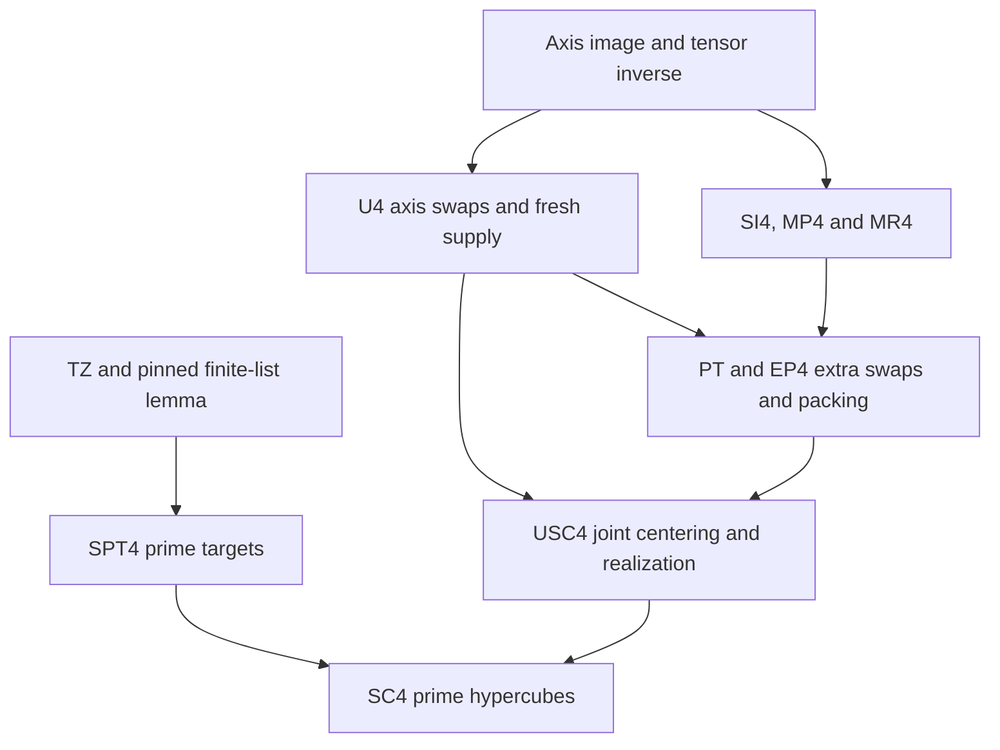

**Public reading copy.** Presentation and links have been normalized. Historical status statements below belong to their source revisions; see the [current publication status](../README.md#review-and-verification-status). The matching original bytes are in the [source archive](../originals/HYPER4_HANDOFF.md).

# Four-dimensional signed-line successor: recovery and ownership

Owner: `/root`; completed reviewed checkpoint in private successor PR81 (archival source; see provenance)
to PR79, branch
`research/signed-prime-hypercube4-20261102`. Manuscript-local labels only;
no permanent claim IDs allocated or changed. The bounded obligation is the
eventual first-odd-prime theorem in dimension four, including every full signed
line and excluding section-sum primality. SC4 and the stronger physical USC4
theorem are proved conventionally and accepted by the four independent internal
reviews below. No mathematical lemma remains open in this composition.
Coordinator integration and its required successful fleet run remain separate.

## Frozen foundation and protection

The scientific cube foundation is PR79 revision
`a2445962ec6e06b2a893980fb7a183057eb9bcee`; delivery
`cdb7879e358f93afa54b685027a27692d22635a9`, tree
`547b78f6e1a30305ebf8853c81d3446fc3407a7f`. The public cube source is
Mira-Cult/math revision `e745a507d0f451620bfa2759a9cd2efc6ff92fb1`,
`notes/sudes-first-conjecture/prime-cube.md`. The imported finite list/controller
interfaces remain pinned to math-wip
`c2118dfad1aeb660d66308dc6a94d6c959f5010c`; newer cutoff work is not silently
substituted. The old checkout and all accepted square/cube manuscripts are
preserved. This successor is isolated and stacked on the completed PR79 branch.

At recovery, PR79 head was the delivery above; PR77 cutoff head was
`b776784e3cffc3aeeb3c3c6886516c3337a16bd1`; PR78 Carmichael head was
`f14161712d3facfd7e65d31322791caeb5c5f9aa`. Main was
`59e00a03e48e71c79a5c1be2cdba66d593cf42a0`. Its AGENTS.md and
RESEARCH_PROTOCOL.md were fetched and byte-compared with the local instructions.
No other lane, branch, public note, approval, or merge is changed by this work.

## Baseline replay before edits

All commands below ran under Python 3.12.14 at exactly the frozen delivery,
before any new scientific file was written. Run from the repository root:

```sh
python3 -B problems/prime-arrays-beyond-square/code/cube_targets_experiment.py --self-test
python3 -B problems/prime-arrays-beyond-square/code/cube_controller_controls.py
python3 -B problems/prime-arrays-beyond-square/code/verify_signed_incidence.py
python3 -B problems/prime-arrays-beyond-square/code/signed_targets_controls.py --self-test
python3 -B problems/prime-arrays-beyond-square/code/signed_trade_controls.py
python3 -B problems/prime-arrays-beyond-square/code/signed_budget_controls.py
python3 -B problems/prime-arrays-beyond-square/code/signed_kernel_certificate.py --self-test
python3 -B problems/prime-arrays-beyond-square/code/check_signed_cube.py --negative-controls problems/prime-arrays-beyond-square/inputs/signed_cube_singleton.json problems/prime-arrays-beyond-square/inputs/array_cube3_signed.json problems/prime-arrays-beyond-square/inputs/array_cube5_signed.json
python3 -B problems/prime-arrays-beyond-square/code/check_array_certificate.py --negative-controls problems/prime-arrays-beyond-square/inputs/cube3_mod3_obstruction.json
python3 -B check.py
```

All nine scientific commands passed. In particular, exact-pool cube certificates
validated 1, 49, and 109 lines at orders 1, 3, and 5; eighteen corruptions were
rejected. The modulo-3 certificate replayed 1,716 central patterns, four survivors,
and divisibility of all six diagonal-square sums; five corruptions were rejected.
This is a finite scope guard, not a four-dimensional obstruction.

The first integrity run in the isolated local clone failed because ordinary
cloning omitted historical, unreferenced review commit objects used elsewhere
in the inherited repository. Recovery copied 287 content-addressed loose objects
from the preserved checkout, verifying equality wherever an object already
existed. It changed no source or old ref. The repeated integrity run then passed,
including all 45 tool regression tests. This distinction is part of recovery;
the initial missing-provenance failure is not reported as a scientific pass.

## Authorship and completed architecture

`/root/hyper_incidence` owns the new integer-incidence source and controls;
`/root/hyper_axis` owns the new physical axis construction;
`/root/hyper_targets` owns the new prime-target source and controls.
`/root` owns joint physical packing, composition, independent certificate checks,
publication and review coordination. These are authorship roles, not independent
review attributions.

The preferred architecture is a five-level axis controller followed by descending
signed-line corrections. The incidence audit finds twelve complementary-pair
trace identities in addition to axis marginals, pair-family margins and
triple-family totals. Independently choosing each prime target matrix would miss
these identities. The common set-of-reflection-orbits target construction now
satisfies all of them. The physical route uses full-diagonal units, triple-family
transfers, coupled pair traces, then matrices with zero margins and both signed
traces zero. Projected rectangles and a bounded marker graph supply the proved
repair for the last matrix controller.

A direct joint tensor inverse is the retained alternative. It needs a comparable
integer norm and placement theorem; rational rank alone does not supply either.
Independent three-dimensional slices do not handle the fourth family of axes.

## Scientific checkpoint and completed review state

The opening recovery commit is `09090c15a199f5f631cedc3c716fd8a9fe0f0ea1`.
The complete author proof and initial source-bound controls are published at
`b837e307fc41975d0fb332c8215d6835ba47a271`, tree
`22b71846ec92f19013a1b0dddd3d8d2524cd770d`. The working decomposition above
is now implemented in canonical sources linked from
[hyper4_cube.md](manuscripts/hyper4_cube.md). They prove SC4 through the
physical USC4 theorem and SPT4; independent nonauthor review has completed.
No numerical threshold, kernel verification, or novelty claim is made.

The extra physical-control checkpoint is
`61755c8ca37f8ab796ca4eefac6af890825b1b68`, tree
`f3b4ec99503cc9796f1c2713db0eea6e7f335b61`. The first three independent
review notes and the reviewer-authored adversarial control are published at
`721f818e113d4e730cfe1c190e79d8abcaca3f1c`, tree
`607f300df182fba32a6542b84ef26835d45de44d`. The final additive delivery
adds the composition review and updates only the handoff and dimension-status
indexes; all five scientific manuscripts remain byte-identical to `b837e307...`.
The PR description records the full delivery head. In any recovered checkout,
`git log -1 --format=%H -- problems/prime-arrays-beyond-square/HYPER4_HANDOFF.md`
identifies the commit containing this final handoff without a self-referential
hash inside the file.

The PR79 branch independently opened its explicit cube-cutoff continuation at
`2b5752d2c2430f0c465af2574497a5ee7b73e7b3` after the initial recovery. This
successor's scientific parent remains the frozen delivery `cdb7879...`; no
cutoff file or hypothesis is imported or changed. Publication is additive.

The new scientific sources are `hyper4_incidence.md`, `hyper4_axis.md`,
`hyper4_trades.md`, `hyper4_targets.md`, and `hyper4_cube.md`. The bounded
primary-source comparison is `hyper4_literature.md`. The completed architecture
ledger and a single joint reserve/drift/capacity table are in the composition
source. No permanent claim IDs or inherited theorem statements changed.

The dependency graph separates numeric liftability from physical realization:



The arrow from U4 to the extra controller uses its independently proved supply
and external-support packing interfaces, not the conclusion of SC4. Joint
centering checks the extra reservation hypotheses before running U4's numerical
passes. Thus the diagram has no circular appeal to an already arranged cube.

### New verification commands and scope

Run from the repository root under Python 3.12.14:

```sh
python3 -B problems/prime-arrays-beyond-square/code/check_hyper4_certificate.py --self-test problems/prime-arrays-beyond-square/inputs/hyper4_singleton.json
python3 -B problems/prime-arrays-beyond-square/code/verify_hyper4_incidence.py
python3 -B problems/prime-arrays-beyond-square/code/hyper4_axis_controls.py
python3 -B problems/prime-arrays-beyond-square/code/hyper4_axis_controls.py --verify problems/prime-arrays-beyond-square/inputs/hyper4_axis_physical.json
python3 -B problems/prime-arrays-beyond-square/code/hyper4_targets_controls.py self-test
python3 -B problems/prime-arrays-beyond-square/code/hyper4_targets_controls.py check problems/prime-arrays-beyond-square/inputs/hyper4_targets_n17.json
python3 -B problems/prime-arrays-beyond-square/code/hyper4_trade_controls.py
python3 -B problems/prime-arrays-beyond-square/code/hyper4_trade_controls.py --verify problems/prime-arrays-beyond-square/inputs/hyper4_forty_pair_trade.json
python3 -B problems/prime-arrays-beyond-square/reviews/hyper4_incidence_adversarial.py
python3 -B check.py --base cdb7879e358f93afa54b685027a27692d22635a9
```

The initial scientific checkpoint's incidence, axis, target and arrangement
controls passed, as did repository integrity and all 45 tool tests. The added
extra-trade controls passed before their next additive publication. Their
scope is distinct:

| Evidence | Result and limit |
|---|---|
| Independent array checker | Counts 272 and 888 lines; singleton `[3]` accepted; eight arrangement and eight geometric corruptions rejected. No order-three/five prime arrangement is asserted. |
| Exact incidence | Full ranks 81 and 572 at orders 3 and 5; explicit unimodular certificates, kernel/dependency/divisibility rows and negative controls verified. The small-order torsion is retained. |
| Axis physical controls | Exact pool of 14,641 odd primes at order 11; eighteen disjoint stages, 52 switch patterns, nineteen signed reference changes, 24 residue-ring cases and eight five-pass numeric compositions passed. This is not a prime-line arrangement. |
| Prime targets | At orders 3,5,17, respectively 272,888,23,400 lines and 154,298,2,170 partition identities checked, with exact pool totals; seven corruptions rejected at each of orders 3 and 5. Targets are not arrangements or small-order lift certificates. |
| Extra physical controls | 256 exact images; actual eight-pair and forty-pair stages; four whole-bundle families; seven corrupted partial certificates rejected. A partial stage is not a full hypercube. |

The precise large-order theorem is supported by the written proofs and review,
not by these finite checks. The reviews bind the exact source commits and raw
manuscript SHA-256 hashes. No scientific revision was required after the freeze.
The first frozen scientific CI run
41515051209 (archival source; see provenance)
was **skipped**, not passed. No workflow, runner, permission or trusted-writer
gate was changed to bypass that result.
The later control/review runs
41515989349 (archival source; see provenance)
and 41518572720 (archival source; see provenance)
were also observed completed with conclusion **skipped**. Local passes below
do not replace the protocol's successful fleet-run requirement for integration.

## Independent reviews

The following fresh nonauthor reviews have actually completed. All reviewed
scientific manuscripts remain byte-identical to `b837e307...`; the separate
extra finite controls are frozen at `61755c8ca37f8ab796ca4eefac6af890825b1b68`.
The opening status text inside immutable scientific sources is historical;
the completed review records below supply the later review status.

| Reviewer | Exact scientific revision and scope | Verdict and record |
|---|---|---|
| `/root/hyper4_incidence_review` | `b837e307fc41975d0fb332c8215d6835ba47a271`; SI4, MP4, MR4 and exact finite lattices | Accepted; [review](reviews/hyper4_incidence_review.md) |
| `/root/hyper4_analytic_review` | `b837e307fc41975d0fb332c8215d6835ba47a271`; HP/HW/SPT4, printed TZ, actual FL, fresh tuple supply under Q* | Accepted; [review](reviews/hyper4_analytic_review.md) |
| `/root/hyper4_geometry_review` | `b837e307fc41975d0fb332c8215d6835ba47a271`; U4/AP4 and PT/EP4; extra control code separately at `61755c8ca37f8ab796ca4eefac6af890825b1b68` | Accepted; [review](reviews/hyper4_geometry_review.md) |
| `/root/hyper4_composition_review` | `b837e307fc41975d0fb332c8215d6835ba47a271`; USC4 and USC4+SPT4 to SC4; frozen controls at `61755c8ca37f8ab796ca4eefac6af890825b1b68`, component records at `721f818e113d4e730cfe1c190e79d8abcaca3f1c` | Accepted; [review](reviews/hyper4_composition_review.md) |

Each reviewer discloses actual authorship boundaries and the precise scope
accepted. These are independent internal agent reviews, not journal refereeing,
formal GitHub approvals, or kernel verification. The component authors' earlier
cross-checks are not counted as these independent reviews.

The incidence reviewer also supplied a new
[adversarial control](../originals/reviews/hyper4_incidence_adversarial.py). It chooses targets
from the equations themselves, then independently sums the returned integer
lift. It passed at orders 17,19,21, checking 23,400,32,080,42,680 lines, and
passed entry congruence `3 mod 17` in a nonconstant order-17 lift. The coordinator
replayed it successfully. The geometry note contains a complete executable
central-compound regression, confirming eight complementary support lines
despite zero complementary images. Neither is a prime-array certificate.

The composition reviewer reran five frozen scientific control commands and
history-aware repository integrity, including all 45 tooling tests. The sole
nonblocking finding was stale dimension-status wording in the problem indexes;
this delivery corrects it to established physical constructions at D=3,4 and
remaining extensions at D>=5. No reviewer requested a mathematical repair.

## Final recovery and next action

The completed obligation is SC4 for every sufficiently large odd n and the exact
pool `{p_2,...,p_(n^4+1)}`. The stronger USC4 realizes every compatible nearby
odd full-line target vector. Its only external mathematical inputs are the
proved interfaces cited at their pinned sources; there is no unresolved
conditional premise. The threshold is ineffective. Section-sum primality,
higher dimensions, formal verification and numerical effectivization remain
outside this completed obligation.

Before final publication, the coordinator reran history-aware integrity after
the index and handoff edits, checked the five scientific files against `b837`,
and checked the inherited square/cube scientific files against `cdb7879...`.
The result and full final head are recorded in the PR delivery description.
Recover the listed source/control and review commits and the final delivery commit;
run the listed commands from the repository root. Small-order incidence
certificates contain explicit integer transformations, so their verifier does
not require the optional producer's third-party Smith-form library.

Next executable action is coordinator review for integration of this completed
checkpoint, retaining the exact scientific/review pins and obtaining the
required successful fleet run. Public exposition requires coordinator
incorporation. This delivery performs no merge, formal approval, public-note
change, branch deletion or new research dispatch, and leaves the independent
cube-cutoff and Carmichael work untouched.
