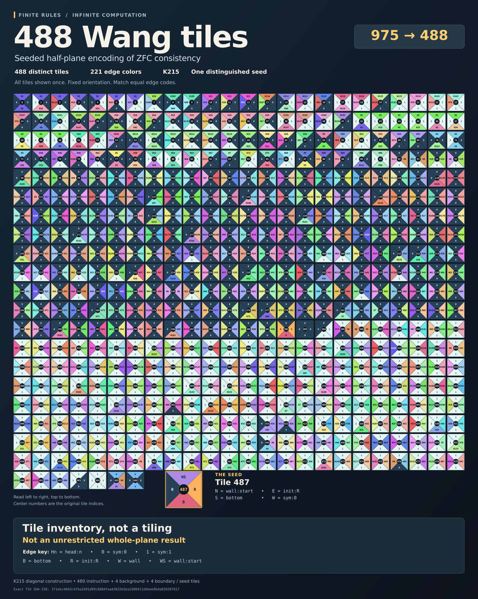

# From 975 to 488 Wang tiles: a seeded half-plane construction

This note gives **488 oriented Wang tile types**, including one distinguished
seed, that tile the half-plane $\mathbb Z\times\mathbb N_0$ with that seed at
the origin if and only if the exact K215 Turing machine never halts from its
blank tape. Here $\mathbb N_0=\{0,1,2,\ldots\}$.

The starting point is Conor Grogan and Claude's
[975-tile seeded construction](https://github.com/jconorgrogan/k230-wang-tiles/tree/1e483bad46dd91d9ad20aa38b7f750986be043fc)
for Elliot Glazer's K230 machine. The reduction has two ingredients: use the
primary 215-state machine, and replace the row-by-row simulation with a
diagonal one. Five further tiles are removed by an all-time invariant.
The final set has **487 fewer tile types**, a reduction of about **49.95%**.

The number 488 counts **tile types**, not Turing-machine states. K215 still
has 215 working states and a separate halt state. This is a correctness
reduction with an ordinary mathematical proof and executable checks, not a
new Lean or Rocq formalization. No minimality, priority, or record claim is
made. The proof and reproduction files below do not require access to the
research repository from which this release was prepared.



The [scalable atlas](488-wang-tiles.svg) shows every tile exactly once.
Its [renderer](render_atlas.py) reads the released TSV directly; see
[ATLAS.md](ATLAS.md) for the edge-code legend and image reproduction.

## The exact statement

Let $T_{488}$ be the set in
[k215_diagonal_488.tsv](k215_diagonal_488.tsv). A row gives the tile's
zero-based index, seed flag, and edge colors in **north, east, south, west**
order. Tiles may be translated, but not rotated or reflected. Neighboring
edges must have equal color names; the names carry no additional rules.

The distinguished seed has index **487** and tuple

```text
(wall:start, init:R, bottom, sym:0).
```

**Theorem.** There is a map
$\tau:\mathbb Z\times\mathbb N_0\to T_{488}$ with matching neighboring
edges and $\tau(0,0)=T_{488}[487]$ if and only if K215 does not halt from
its all-zero two-way infinite tape, starting in state 0 at tape cell 0.

The exact K215 input is the
[primary dense table](https://github.com/VladimirReshetnikov/ProveIt/blob/440dd03ab8de73ba5ea5218c37527a6edb7e5d8b/Computability/BusyBeaver/Research/ZFC/candidate-k215/k215.tm)
at commit `440dd03ab8de73ba5ea5218c37527a6edb7e5d8b` of
`VladimirReshetnikov/ProveIt`. It has 430 explicit rows on working states
0 through 214. Its only transition into halt state 215 is
`68 1 1 R 215`, in `state read write direction target` format.

This theorem concerns a **seeded half-plane**, not unrestricted whole-plane
tileability. In fact, $T_{488}$ contains the constant tile
`(sym:0, sym:0, sym:0, sym:0)`, which tiles the ordinary plane periodically.
Putting the distinguished seed in the whole plane would instead be
impossible: its south color `bottom` occurs on no north edge. The boundary
and seed in the theorem are essential.

## Where the tiles are saved

The old encoding uses one row per machine step. An action tile executes
the transition; an adjacent merge tile creates the next head. The original
975 types comprise 460 actions, 510 merges, and five ancillary tiles.

In the diagonal encoding, a rightward TM move carries the head **east**,
and a leftward TM move carries it **north**. The tape follows a
northwest-to-southeast frontier. The instruction tile both executes the
transition and transmits the next state, so the separate merge family
disappears. Four symbol tiles preserve the tape around the moving head.

These counts use the literal pinned machine tables. Every entry has the
same seeded-half-plane semantics.

| Construction | K230 | K215 |
| --- | ---: | ---: |
| Original action/merge encoding | 975 | 923 |
| Action/merge encoding, sharing identical instruction payloads | 824 | 790 |
| Diagonal encoding | 516 | 494 |
| Diagonal, omit the transition into the dead halt state | 515 | 493 |
| Diagonal, also remove certified impossible inputs | 507 | **488** |

Changing the machine alone saves 52 tiles in the old encoding. The larger
saving comes from changing the simulation geometry: even K230 has a
507-tile version under the same checked pruning method.

For K215, the final count is

$$
\boxed{480\text{ instruction tiles}+4\text{ symbol tiles}
+4\text{ boundary/seed tiles}=488.}
$$

## A complete diagonal compiler

Let $M$ be a deterministic partial binary Turing machine. Write
$\delta(q,a)=(q',b,d)$ for an instruction that reads $a$, writes $b$, moves
in direction $d\in\{L,R\}$, and enters $q'$. An undefined instruction halts
the computation. Use distinct symbol colors $s_0,s_1$, state colors $h_q$,
and the four fresh boundary colors described below.

All tuples in this section are ordered $(N,E,S,W)$.

### Four symbol tiles

For each $a,b\in\{0,1\}$, include

$$
(s_a,s_b,s_b,s_a).
$$

This passes the west input to the north and the south input to the east.
Along the ordered tape frontier it preserves the two symbols' order.

### Instruction tiles

For each defined instruction, use the following tiles when its incoming
orientation is possible:

| Instruction | Head arrives from west | Head arrives from south |
| --- | --- | --- |
| $\delta(q,a)=(q',b,R)$ | $(s_b,h_{q'},s_a,h_q)$ | $(s_b,h_{q'},h_q,s_a)$ |
| $\delta(q,a)=(q',b,L)$ | $(h_{q'},s_b,s_a,h_q)$ | $(h_{q'},s_b,h_q,s_a)$ |

Let $D(q)$ be the set of directions of all instructions entering $q$, with
$R$ also included for the starting state. Include the west-arrival copy
only when $R\in D(q)$ and the south-arrival copy only when $L\in D(q)$.
This filter is sound: an east output enters the next tile from the west,
and a north output enters it from the south. The extra initial orientation
is supplied by the boundary. No instruction tiles are supplied for an
undefined transition.

### Four boundary tiles

Introduce fresh colors `bottom`, `init:R`, `wall:start`, and `wall`, and
add:

| Tile | North | East | South | West |
| --- | --- | --- | --- | --- |
| Distinguished seed | `wall:start` | `init:R` | `bottom` | $s_0$ |
| Bottom initializer | $s_0$ | `init:R` | `bottom` | `init:R` |
| First wall cell | `wall` | $h_{\mathrm{start}}$ | `wall:start` | $s_0$ |
| Remaining wall | `wall` | $s_0$ | `wall` | $s_0$ |

Require the seed at $(0,0)$. The initializer is the only tile with west
color `init:R`, so it is forced at every $(x,0)$ with $x>0$. The first
wall cell is the only tile with south color `wall:start`, so it is forced
at $(0,1)$. The remaining wall is then forced at $(0,y)$ for all $y\ge2$.

These rays supply blank inputs to the quadrant $x,y\ge1$, except for
one starting head entering $(1,1)$ from the west. The region $x<0$ can
be filled with $(s_0,s_0,s_0,s_0)$, matching the west side of the seed
and wall. Its possible other fillings cannot change the quadrant's fixed
inputs. The boundary tiles cannot appear inside that quadrant: their
southwest inputs do not match a pair of state/symbol colors. Also, no tile
has north color `bottom`, so neither the seed nor the initializer can
occur above row zero.

## Proof that the compiler preserves nonhalting

Process the computation quadrant by increasing antidiagonal $x+y$.
Each antidiagonal has finitely many cells. Its south and west inputs are
fixed by the boundary or by the preceding antidiagonal, so every cell
depends only on finite earlier data.

Read the edges crossing the staircase frontier from northwest to
southeast, extending its ends by the unused blank boundary rays. They
represent the two-way tape with one head marker. A head arriving from
the west scans the adjacent symbol to its right in this word. A head
arriving from the south scans the adjacent symbol to its left. This
orientation convention matters when the machine reverses direction.

Filling a cell replaces its incoming frontier pair $(W,S)$ by its
outgoing pair $(N,E)$:

- A symbol tile replaces $(s_a,s_b)$ by $(s_a,s_b)$. The ordered tape
  word does not change.
- A head tile consumes either $(h_q,s_a)$ or $(s_a,h_q)$. A rightward
  instruction produces $(s_b,h_{q'})$ with the head exiting east and
  scanning its next right neighbor. A leftward instruction produces
  $(h_{q'},s_b)$ with the head exiting north and scanning its next left
  neighbor. In each case the scanned cell becomes $b$.

Thus each head tile performs exactly one ordinary machine step, including
on a reversal. Symbol tiles neither create nor erase a head. A head tile
consumes one head and produces one, so each completed antidiagonal has
exactly one outgoing head. It enters the next antidiagonal, whose other
input is the appropriate adjacent tape symbol by the frontier invariant.

The $t$-th head cell, counting the first one as $t=0$, has coordinates

$$
(x,y)=(1+\#R,1+\#L),\qquad
\text{tape position}=x-y,\qquad t=x+y-2.
$$

For any southwest input pair that occurs in this computation there is
at most one matching tile. Two symbols force their symbol tile; one
head and one symbol force the corresponding instruction, if defined.
Two incoming heads never occur. The fixed boundary and this local
determinism force every antidiagonal of any candidate seeded tiling.

If $M$ never halts, the frontier invariant supplies a matching tile at
every cell. The union of the successively filled finite antidiagonals,
together with the boundary and the blank left exterior, is a tiling of
the required half-plane. If $M$ halts, the forced head reaches a cell
with no matching instruction tile at a finite antidiagonal. No seeded
tiling can pass that obstruction. Therefore

$$
\operatorname{SeededHalfPlaneTiling}(\operatorname{compile}(M))
\quad\Longleftrightarrow\quad
M\text{ does not halt on blank tape}.
$$

The argument gives both directions; it is not merely a recipe for turning
a known infinite execution into one particular tiling.

## From 494 to 488 for the exact K215 table

### The first deletion: omit the halt-producing instruction

A transition into a state with no outgoing instructions can be omitted
without changing whether execution is infinite. If the original execution
takes it, the original machine halts one step later and the modified
machine stops immediately. Otherwise their runs agree. This changes a
finite halting time, not the nonhalting predicate used by the theorem.

K215 has 243 distinct incoming state/direction pairs among its working
states, including its needed initial orientation. Two read symbols give
486 instruction tiles; four symbol and four boundary tiles give 494.
The unique halt-producing instruction has only one possible incoming
orientation at its source state, so omitting it leaves **493** tiles.

### Five impossible inputs

An incoming direction describes the preceding TM move: $L$ means the
head tile is entered from the south. Remove these five instruction variants:

| State | Incoming direction | Impossible scanned bit |
| --- | --- | ---: |
| 10 | L | 1 |
| 11 | L | 1 |
| 35 | L | 1 |
| 42 | L | 0 |
| 134 | L | 0 |

There is a direct proof from the complete transition table. The following
lists contain **all** transitions entering the named intermediate states:

| Intermediate state | Predecessor state/read pairs | Every incoming transition |
| --- | --- | --- |
| 106 | (92,0), (101,0) | Writes 0, moves R |
| 14 | (8,0), (123,0) | Writes 0, moves R |
| 39 | (27,0), (119,0), (134,0) | Writes 0, moves R |
| 56 | (43,0), (72,0) | Writes 0, moves R |
| 24 | (17,0), (21,0), (41,0), (45,0), (139,0) | Writes 0, moves R |
| 49 | (61,0), (81,0), (156,0) | Writes 0, moves R |
| 82 | (73,1) | Writes 1, moves R |
| 79 | (71,1) | Writes 1, moves R |

None is the initial state 0. All left-moving entries into the five target
states are precisely:

```text
(106,1)                 -> (10,0,L)
(14,0), (39,0), (56,0) -> (11,0,L)
(24,0), (49,0)         -> (35,0,L)
(82,1)                 -> (42,0,L)
(79,1)                 -> (134,1,L)
```

The right-hand tuples are `(target state, written bit, direction)`.
Each such left move returns to the cell just written by the preceding
right move. The intervening instruction writes only the adjacent cell,
so the returned bit is 0 in states 10, 11 and 35, and 1 in states 42 and
134. This proves the five impossibilities for every execution time,
indeed for any initial tape when the initial state is 0.

### A finite inductive certificate

The same deletions are supported by
[k215_window_certificate.json](k215_window_certificate.json), checked
against the original, untrimmed K215 table. Its 1,173 abstract
configurations record the state, incoming direction, and three consecutive
tape bits centered at the head. The blank initial abstraction is included.
In the JSON, an entry is `[q, w, d]`, where
$w=a_{-1}+2a_0+4a_1$ records the left, scanned, and right bits. If the
instruction writes $b$, a right move gives $(b,a_1,e)$ and a left move
gives $(e,a_{-1},b)$, where $e\in\{0,1\}$ is the newly exposed bit.

After writing the middle bit and moving the head, one outer bit becomes
newly exposed. The certificate is closed under **both** possible values
of that bit, not just a blank value. Consequently the abstraction of any
actual successor is included. Induction on the number of steps proves
that every finite-time configuration is covered. Projecting to state,
incoming direction, and scanned bit excludes exactly the five variants
above among the 493-set's instruction tiles.

[window_invariant.py](window_invariant.py) supplies a bit-shift producer
and a separate list-based closure checker. The checker also verifies the
initial state and blank configuration. The compiler explicitly retains
the initial west-arriving blank head, whose abstract incoming label is
otherwise the special tag `start`.

This is a finite **invariant**, not a bounded execution trace. A long
simulation alone would not justify deleting unused tiles.

If K215 is nonhalting, its forced quadrant never needs any of the five
removed tiles, so it is still a tiling using the 488-type subset.
Conversely, a tiling using the subset is also a tiling using the
493-type set and therefore implies nonhalting. Together with the
halt-target omission, this proves the stated theorem for $T_{488}$.

## What follows about ZFC

The upstream
[K215 ordinary proof](https://github.com/VladimirReshetnikov/ProveIt/blob/440dd03ab8de73ba5ea5218c37527a6edb7e5d8b/Computability/BusyBeaver/Research/ZFC/candidate-k215/proof.md)
supplies the machine-to-proof-search calibration, stated to be
formalizable in ZFC:

$$
\mathrm{ZFC}\vdash
\bigl(\neg\operatorname{Halt}(K215,\mathrm{blank})
\leftrightarrow\operatorname{Con}(\mathrm{ZFC})\bigr).
$$

Taking that pinned source calibration as a premise, the elementary
compiler and pruning proof above give

$$
\mathrm{ZFC}\vdash
\bigl(\operatorname{SeededHalfPlaneTiling}(T_{488},487)
\leftrightarrow\operatorname{Con}(\mathrm{ZFC})\bigr).
$$

Thus, if ZFC is consistent, the seeded tiling exists and ZFC cannot
prove its existence, by the second incompleteness theorem. To conclude
also that ZFC cannot refute the tiling statement, use a suitable stronger
assumption, for example $\Sigma_1$-soundness. Mere consistency does not
by itself establish that second unprovability claim.

The upstream external Lean and Rocq endpoints identify the literal
machine's finite halting with a finite ZFC refutation. Their full
dependency closures were not rebuilt for this release, and an external
proof-assistant theorem is not itself an already encoded internal ZFC
derivation. The new tile compiler and pruning proof here are ordinary
mathematics with executable finite certificates, not new kernel-checked
tiling theorems. [SOURCES.md](SOURCES.md) gives the exact endpoints and
the source-verification boundary.

## Reproduce the released set

Use Python 3.10 or later; the programs need only the standard library.
Run these commands from this directory. The fetcher downloads the two
public machine inputs at exact pinned commits and rejects unexpected
SHA-256 hashes. The raw upstream machine files are not redistributed here.

```bash
python fetch_sources.py /tmp/wang-inputs
mkdir -p /tmp/wang-check
python tm_to_wang.py /tmp/wang-inputs/k215.tm \
  /tmp/wang-check/k215_diagonal_488.tsv \
  --trim-halt --prune-radius 1 \
  --certificate /tmp/wang-check/k215_window_certificate.json
cmp k215_diagonal_488.tsv /tmp/wang-check/k215_diagonal_488.tsv
cmp k215_window_certificate.json /tmp/wang-check/k215_window_certificate.json
python verify.py --k215 /tmp/wang-inputs/k215.tm \
  --k230 /tmp/wang-inputs/k230.tm --output /tmp/wang-check/results.json
python independent_check.py /tmp/wang-inputs/k215.tm \
  --output /tmp/wang-check/independent-check.json
```

The expected tile count is 488 and the seed index is 487. The exact hashes
are:

| Artifact | SHA-256 |
| --- | --- |
| K215 source input | `fdbcef0825886035c3091c8537a69535bc96f9e265f0ae45863543d40ae70090` |
| Released 488-tile TSV | `371ebc4063c47ba3491d99c6884faa43633d3ea2600411d9eee9b4a020207017` |
| Three-cell invariant certificate | `b2f347a7bdb17320ad32a6d18347bf1a2d987b8ab5f966aa8bac9397eab7a62a` |

The verifier compares a literal-edge tiling solver with a separate
ordinary TM simulator. The tiling solver chooses outputs only from the
provided tile tuples; it does not consult the machine table to fill a
cell. Its checks cover:

- All 6,561 partial binary two-state machines, 12 steps each, before and
  after certified pruning and halt-target omission.
- 2,000 fixed-seed random one-to-seven-state machines on nonblank tapes,
  40 steps each, testing the computation core separately from its blank
  boundary.
- K215 and K230, 1,000 steps each, in the original and reduced diagonal
  encodings.
- Boundary forcing, tile uniqueness, complete TSV readback, finite
  invariant closure, and negative controls for an incorrect initial
  state or a missing invariant successor.

All these checks passed again for this public release. Their finite lengths do
not prove nonhalting; the infinite equivalence follows from the proof.
[independent_check.py](independent_check.py) additionally checks the exact
source hashes, three-cell closure, complete predecessor data, 488-tile
reconstruction, southwest determinism, and boundary forcing without
importing either the compiler or its invariant checker.
[SOURCE.json](SOURCE.json) binds the release to its research-source
commit and records the public artifact hashes. See
[ATTRIBUTION.md](ATTRIBUTION.md) for upstream contributions and licensing.

## Attribution and prior work

Conor Grogan and Claude's [975-tile construction](https://github.com/jconorgrogan/k230-wang-tiles/tree/1e483bad46dd91d9ad20aa38b7f750986be043fc)
provides the comparison and the seeded-half-plane target. Its K230 input
comes from [Elliot Glazer's development](https://github.com/elliotglazer/k230-rocq/tree/a8312f0ca703bc81baac16695a437a7d3788f690).
The exact K215 machine and its calibration are taken from the pinned
[ProveIt source](https://github.com/VladimirReshetnikov/ProveIt/tree/440dd03ab8de73ba5ea5218c37527a6edb7e5d8b/Computability/BusyBeaver/Research/ZFC/candidate-k215).

Diagonal computation predates this compiler. For example, Emmanuel
Jeandel and Pascal Vanier, [*Π⁰₁ sets and tilings* (2011), §3](https://arxiv.org/html/1102.1189v2#S3),
describe northeast time and northwest-to-southeast tape diagonals. That
precedent does not certify this exact tile family or its 488 count; those
are established by the explicit construction, proof, and data above.
